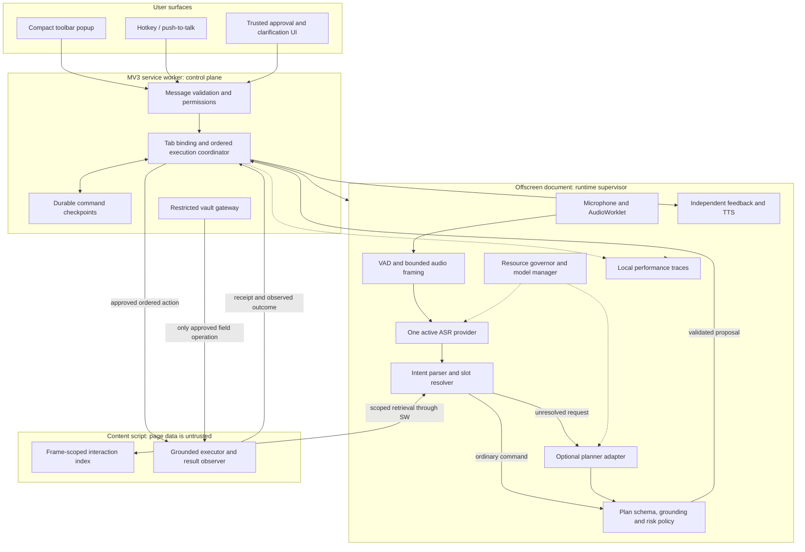

# VoxPilot: architecture and optimization roadmap

**Status:** proposed engineering plan, grounded in the current repository.  
**Reviewed:** 15 November 2026.  
**Purpose:** make ordinary voice control fast, reliable, and useful on modest hardware, with advanced AI as an optional upgrade.

This document specifies changes to make. It does not claim they are already implemented or that the performance targets below have been achieved. See [release readiness](RELEASE_READINESS.md) for the changes already shipped and their verification limits.

## 1. The main architectural decision

**Build a voice command system with optional AI planning.** Common scrolling, navigation, clicking, selecting, and field entry should require neither a GPU nor an LLM download. The user should pay the cost of general reasoning only when a command actually needs it.

The current recovery fixes make failures less damaging, but recovery and longer timeouts cannot make a heavyweight pipeline inexpensive. A smaller fallback after a GPU crash is useful protection; choosing an appropriate workload before a crash is the next step.

The recommended default is:

1. A lightweight local speech recognizer, selected using real device benchmarks.
2. A deterministic command parser and page-grounding engine.
3. A separate, optional compact planner for requests that remain unresolved.
4. An execution engine that validates, acts, observes the result, and reports truthfully.
5. A small popup that controls the background runtime without owning it.

Fully offline, arbitrary-language reasoning with cloud-level speed on every low-end machine is not a realistic guarantee. Keep the core experience useful without that guarantee. Optional cloud or native-companion modes have different privacy, deployment, and cost requirements; they must be separate product decisions, never silent fallbacks.

## 2. What the repository actually does today

The following are source observations, not benchmark results. Code comments, model parameter counts, and timeout constants are not measured throughput.

| Area | Current implementation | Consequence / change needed |
|---|---|---|
| Startup | [AgentCore](../src/offscreen/agent/agent-core.ts) starts STT and WebLLM for every selectable profile. | Basic voice control still pays for optional reasoning. Separate feature readiness and lazy loading. |
| Model profiles | [Constants](../src/shared/constants.ts) select Llama 1B/3B/8B plus Whisper tiny/base. The README's older Lite/Standard/Enhanced table disagrees. | Establish one manifest and generate accurate UI/documentation from it. |
| Model readiness | Setup completion is tied to both workers; progress uses STT/LLM weighting. | Users without a working GPU cannot complete a genuinely lightweight setup. Make the planner optional. |
| Audio | [AudioWorklet](../public/audio-processor.js) hardcodes 2,048 native-rate samples per message; the capture `bufferSize` option does not configure it. | At 16 kHz this is 128 ms of packet buffering; at 48 kHz it is about 43 ms. Use duration-based framing and measure the actual sample rate. |
| Voice activity detection | [VAD](../src/offscreen/audio/vad.ts) uses energy thresholds and a 300 ms endpoint hangover. The Silero integration is a placeholder. | Noise and endpoint quality need a real evaluation; documentation must match implementation. |
| Speech recognition | [Whisper worker](../src/offscreen/stt/stt-worker.ts) transcribes the completed utterance using q8 WASM. | Audio recognition is mostly added after the user finishes speaking. Evaluate genuine streaming ASR. |
| Confidence | The STT result reports `confidence: 1.0` unconditionally. | This cannot be used as calibrated recognition confidence or a safety signal. |
| Fast commands | [IntentRouter](../src/offscreen/agent/intent-router.ts) already bypasses the planner; named targets are grounded using a fresh snapshot. | Expand this useful path and measure its coverage. It still waits for STT. |
| Page context | [SnapshotBuilder](../src/content/snapshot.ts) collects interaction geometry, headings, and text. [Planner](../src/offscreen/agent/planner.ts) includes up to 4,000 characters of element descriptions plus page content. | Avoid collecting/sending article text for a click. Retrieve only relevant candidates. |
| Completion | [Service worker](../src/sw/sw.ts), `completePlan()`, awaits spoken feedback before final completion. | A completed click can remain “busy” while its summary is spoken. Decouple execution and feedback. |
| Execution transport | [Plan execution](../src/sw/plan-execution.ts) checks stored cancellation state and messages the page for each DOM action. | Preserve cancellation while reducing storage and messaging overhead where measurements justify it. |
| GPU planner | 4,096-token context, maximum 384 output tokens, bounded loss recovery to SmolLM2 360M. | These are limits, not latency guarantees. Prefill size is compiled into the model library; the removed runtime override did not work. |
| Memory | Pause releases the mic but retains models. | Good for rapid resume, costly during long idle periods. Add an explicit resource policy. |
| Packaging | Current local `dist/` is about 60 MiB uncompressed, excluding downloaded model weights. Two copies of the JSEP ONNX WASM are byte-identical, each 21,596,019 bytes. | Audit asset resolution and ship one required copy. Do not delete assets until cold/warm/offline paths are verified. |
| Model registry | [ModelStore](../src/offscreen/model-store.ts) is not imported by runtime code, has TODO hashes, and describes a different profile mapping. | It is not an active integrity layer. Replace the parallel registry rather than building more functionality on its assumptions. |
| Quality evidence | Existing automated tests primarily mock inference and browser APIs. | Add actual audio, browser, model, and hardware benchmarks. Passing unit tests does not establish responsiveness. |

User reports establish that long delays and GPU losses occur. They do not establish p50/p95 latency, available VRAM, or the proportion of time spent in each stage. Collect those before attributing every delay to the GPU.

## 3. Product modes and hardware policy

Replace model-size-first profiles with capability-first modes. The names below are proposed.

| Mode | Intended use | Speech / routing | Planner | Hardware policy |
|---|---|---|---|---|
| **Essential — default** | Everyday hands-free control | Qualified local CPU ASR + rules + page index | None required | Must be usable without WebGPU; English first, then explicitly supported language packs. |
| **Assist — optional** | Ambiguous commands and short workflows | Same dependable core | Qualified compact local model, loaded on demand | Enable after a compatibility and warm-up test; keep basic commands available during failure. |
| **Advanced — optional** | More complex reasoning or longer text | Same core | Larger local model only if measured benefit justifies it | Explicit download, memory, power, and latency tradeoffs. Never an automatic upgrade. |
| **Companion — future option** | Users wanting native acceleration | Browser remains responsible for permissions/actions | Signed local companion through Native Messaging | Additional installation, update, authentication, and OS support work. Not a prerequisite for Essential. |
| **Remote assist — separate decision** | Low local compute with network reasoning | Keep control and policy local | Explicitly selected remote provider | Requires consent, data minimization, costs, retention policy, and network failure handling. Off by default; conflicts with an unconditional zero-cloud claim. |

**Do not publish minimum hardware specifications yet.** Start qualification with CPU-only 4-core/8-GB machines, common integrated-GPU laptops, Apple Silicon, and a stronger reference GPU. These are test cohorts, not promises that every device in a cohort will meet the targets. Record actual OS, browser version, model revision, memory pressure, and power mode.

Capability selection should use feature detection, successful initialization, a bounded warm-up, and observed latency/failure rate. `navigator.gpu`, reported system RAM, or a GPU model name alone does not establish usable memory or sustained speed.

## 4. Proposed architecture

### 4.1 Component and trust boundaries



The arrows between contexts are logical channels implemented through validated Chrome runtime/tab messages. They are not direct object access. Keep browser privilege in the service worker; keep inference away from the page; keep passwords and payment values out of the planner.

Offscreen supports DOM/media/worker work while the popup is closed, but its extension API access is restricted to `chrome.runtime`. Do not turn it into an unrestricted background page. Service workers may terminate and must reconstruct control state. These are platform constraints, not optional refactors. [Chrome offscreen API](https://developer.chrome.com/docs/extensions/reference/api/offscreen?hl=en), [service-worker lifecycle](https://developer.chrome.com/docs/extensions/develop/concepts/service-workers/lifecycle?hl=en).

### 4.2 Ordinary-command path

```mermaid
sequenceDiagram
  participant U as User
  participant A as Audio / ASR
  participant R as Router
  participant P as Page index
  participant S as Policy / SW coordinator
  participant E as Page executor
  participant F as Feedback
  U->>A: Speak command
  A-->>U: Partial transcript / listening feedback
  A->>R: Stable final transcript + utterance ID
  R->>P: Retrieve relevant targets if needed
  P-->>R: Candidates + frame/document revision
  R->>S: Deterministic action proposal
  S->>S: Validate, ground and classify
  opt User approval required
    S->>U: Show exact action and destination
    U->>S: Approve matching command/revision
  end
  S->>E: Execute one bounded step
  E-->>S: Observed result / failure receipt
  S-->>U: Action complete; next command may start
  S-->>F: Optional short confirmation
```

An LLM is absent from this path. A partial transcript may prefetch page candidates or prepare a model, but it must not trigger a page mutation. The safety gain from finalization is more important than speculative clicks.

### 4.3 Separate state machines

Maintain three independent concerns instead of one growing `AgentState`:

| Concern | Example states | Owner |
|---|---|---|
| Microphone | off → starting → listening → stopping / permission error | Audio controller |
| Command | idle → recognizing → resolving → planning → awaiting approval → executing → verifying → terminal | Runtime + SW coordinator |
| Model | absent → downloading → cached → initializing → ready → evicted / failed | Model manager |

Feedback has its own cancellable queue. A spoken summary can still be playing after a command is terminal. It must not keep execution locks, and echo handling must prevent that summary from becoming a new command.

## 5. Contracts that make the architecture reliable

Add explicit contracts before splitting `AgentCore` into more files. The following is an illustrative design, not a drop-in implementation:

```ts
type CommandIdentity = {
  commandId: string;
  utteranceId: string;
  cancellationEpoch: number;
  tabId: number;
  frameId: number;
  documentId: string;
  pageRevision: number;
};

type ExecutionReceipt = {
  commandId: string;
  stepId: string;
  outcome: "applied" | "verified" | "failed" | "unknown";
  evidenceCode: string;
  reversible: boolean;
};

type FeatureReadiness = {
  microphone: "off" | "ready" | "error";
  recognition: "loading" | "ready" | "error";
  planning: "disabled" | "loading" | "ready" | "error";
};
```

Every asynchronous result must match the current identity/generation before it changes state. A handle is meaningful only within its frame and document. Confirmation approves a specific operation and destination, not any future plan with a similar label.

Use runtime validation and a sender/role allowlist for messages. `target: "sw"` routes a message; it does not authenticate it. Reject malformed payloads, unknown action types, oversized inputs, unsupported protocols, and stale results.

Journal intent, approval, dispatched steps, receipts, cancellation, and terminal state. If a worker dies after a side effect but before its acknowledgement, record an unknown outcome and inspect the page. Do not replay a purchase, submission, or deletion. Browser automation cannot promise universal exactly-once side effects.

## 6. Measure the latency users experience

### 6.1 Record separate timestamps

Create one trace ID per command and record:

`physical speech end → endpoint declared → ASR final → route resolved → page retrieval complete → planner first token/final proposal if used → validation/approval → dispatch → observed action result → first feedback → feedback complete`.

For benchmark SLOs, obtain **physical speech end from annotated reference recordings**, aligned to the audio sample timeline. The live extension cannot directly observe that ground truth: label estimated acoustic boundaries and VAD-declared endpoints as proxies. Do not start the benchmark clock at VAD's declaration and accidentally exclude the endpointing delay.

Also record model download, initialization, first inference, queue wait, worker restart, and model/backend selection. Measure within each context using monotonic clocks; correlate messages explicitly. Do not subtract unrelated `performance.now()` values from different contexts without clock alignment.

Use local aggregate traces without audio, page text, field values, or full URLs by default. A support export should show stage durations and error codes; including content requires a separate deliberate action.

### 6.2 Use the right latency equation

For the current batch-ASR path:

```text
speech-end-to-action = endpoint wait + remaining ASR work + routing
                    + page retrieval + optional planning + policy + execution/verification
```

Streaming can move recognition work before physical speech end. It does not make the work free. Speaking a long confirmation adds perceived waiting if command readiness remains coupled to TTS.

Report **first visible action**, **verified completion**, and **first useful feedback** separately. A quick “working…” animation is not a fast completed command. Report end-to-end percentiles directly; the sum of component p95 values is not an end-to-end p95.

### 6.3 Initial engineering targets, subject to benchmark qualification

These are proposed acceptance goals for defined supported cohorts, not current results.

| Metric | Initial target | Conditions |
|---|---|---|
| Warm ordinary voice command → first acknowledged action | p50 ≤1.0 s; p95 ≤2.0 s after physical speech end | Essential, supported language, 1–5-second utterance, no human approval, stable page |
| Typed deterministic command → action acknowledgement | p95 ≤250 ms | Warm runtime and local page; exclude network navigation completion |
| Compact-planner command → first useful action | p50 ≤3 s; p95 ≤6 s | Warm qualified Assist device, short bounded task; benchmark before promising |
| Hotkey/button cancellation acknowledgement | p95 ≤150 ms | No new steps after cancellation is observed; an already-applied action cannot be undone by a deadline |
| Voiced stop | Measure speech-end-to-cancel separately | Includes endpointing/ASR; do not claim the hotkey's deadline for spoken stop |
| Warm mic resume → capture ready | p95 ≤500 ms | Permission already granted; separately record OS/browser interruptions |
| Snapshot main-thread slices | Aim ≤8 ms per slice | Yield across slices; record total capture latency and truncation too |
| Essential command coverage | ≥90% of a representative command corpus without a planner | Publish the command classes and clarification rate |
| Correct ordinary-task completion | ≥95% on the agreed evaluation set | Include wrong-target and unintended-action rates; a fast wrong action fails |

Use an initial warm-command budget to allocate work, not to fabricate measured results: approximately 200 ms endpointing, 400 ms remaining ASR, 60 ms routing/retrieval, and 150 ms dispatch/verification leaves limited headroom inside a one-second median. If measured ASR alone takes several seconds, optimize or replace ASR before polishing a few milliseconds of IPC.

## 7. Speech recognition and audio: the largest pipeline opportunity

### 7.1 Evaluate recognizers rather than choosing by model popularity

| Candidate | Why evaluate it | Main tradeoff / acceptance condition |
|---|---|---|
| Current Whisper tiny q8/WASM | Existing baseline; useful for general speech | Whole-utterance latency and CPU cost; measure warm/cold and noisy speech |
| Command-oriented streaming ASR, e.g. sherpa-onnx WASM | Incremental decoding can overlap speech and recognition | Validate exact model language coverage, binary/model size, command accuracy, and MV3 packaging |
| Browser-native on-device recognition | May reuse platform-managed local speech capabilities | Probe API and installed language support; require local processing; do not assume availability or automatic language installation |
| Whisper with a qualified accelerated backend | May improve transcription on some devices | Benchmark contention and battery use alongside the planner; do not run both GPU workloads blindly |
| Native companion ASR | Can use native runtimes and platform acceleration | Installation, signing, permissions and update burden; optional later work |

Sherpa's own build documentation demonstrates real-time browser ASR using WASM; it does not establish that a particular model is smaller or faster for VoxPilot. Run the same recordings through both candidates. [Sherpa WASM build guide](https://k2-fsa.github.io/sherpa/onnx/wasm/build.html).

If browser-native local recognition is evaluated again, implement it behind the same ASR interface and activate **one recognizer at a time**. Require `processLocally`, probe availability, and handle missing packs visibly. Never restore the old independently running popup recognizer or fall back silently to remote recognition. [On-device speech proposal and capability APIs](https://github.com/WebAudio/web-speech-api/blob/main/explainers/on-device-speech-recognition.md).

For each candidate measure command accuracy, entity/slot accuracy, final-word clipping, false activations, real-time factor, speech-end-to-final delay, peak memory, download size, and sustained CPU/power. Include accents, laptop fans, pauses inside a sentence, product names, addresses, and code-switching if that language combination is supported.

### 7.2 Audio and endpoint changes

- Replace the hardcoded packet size with approximately 20–32 ms framing where compatible with the selected VAD. Express it in time and actual input sample rate. Respect the pinned VAD model's required frame shape rather than assuming every Silero version accepts the same frames.
- Keep AudioWorklet work bounded. Put resampling/VAD outside the UI thread, and keep ASR compute from blocking VAD/cancellation processing.
- Use a short bounded pre-roll so speech beginnings are not lost. Trim unnecessary trailing silence without clipping the last word.
- Test adaptive endpointing around 150–300 ms against the existing 300 ms baseline. Shorter hangover is not automatically better if it splits commands or truncates speech.
- Use transferable buffers and a bounded pool before introducing shared-memory complexity. A stateful resampler should preserve timing across frame boundaries.
- Consider a small dedicated local stop detector only after measuring voiced cancellation. Keep the hotkey/button cancellation path independent of all neural inference.
- Offer push-to-talk for battery-sensitive and noisy environments. Always-on listening should be a conscious mode, with an obvious indicator and immediate pause.

WASM threading requires compatible browser/runtime conditions, including cross-origin isolation for relevant shared-memory support. Verify the extension context and pinned ONNX build before changing `numThreads`; use a tested single-thread fallback. Do not assume setting COOP/COEP or maximizing thread count automatically improves latency. [ONNX Runtime environment options](https://onnxruntime.ai/docs/tutorials/web/env-flags-and-session-options.html).

## 8. Make ordinary commands deterministic and page context selective

### 8.1 Expand the parser in stages

Normalize punctuation and polite phrases; parse intent and slots; retrieve page candidates; rank them; execute only when one grounded interpretation meets a tested threshold. Use exact accessible-name matches first, then normalized aliases and contextual ranking. Ask a short clarification when two targets remain plausible.

Measure whether an embedding/reranking model is actually needed. Lexical matching and a good interaction index may cover most commands without another model download. If ML ranking is added, include its memory and latency in Essential's budget.

Keep number-based selection, navigation, scrolling, focus, field selection, tab management and saved deterministic workflows available without an LLM. Do not interpret invented `confidence: 1.0` as proof a transcript is right.

### 8.2 Build a revisioned interaction index

Index relevant interactive elements: role, accessible name, input type, enabled state, visibility, form association and frame/document identity. Update it from debounced mutations and invalidate on navigation. Time-slice expensive work; an initial `querySelectorAll` or layout read can still be expensive even when later loops have deadlines.

Use separate retrieval requests:

- `findInteractiveTargets(query, scope)` for click/type/select.
- `getReadableContent(scope, budget)` for reading/questions.
- `getFormSchema(form)` for form operations.

Start planner retrieval with roughly 10–20 relevant candidates, then ask for more if evidence is insufficient. This is an experiment parameter, not a universal cutoff. Do not drop offscreen but relevant targets solely to make the model prompt smaller.

Revalidate the chosen element immediately before execution. Reject stale handles; never silently redirect them to another element. Multiple frames and shadow roots need deliberate routing and permission handling; current top-frame support should stay explicit until those cases are implemented and tested.

## 9. Keep the planner small, bounded, and optional

Introduce a `PlannerProvider` interface with lifecycle, capability, cancellation, and structured-output methods. Put WebLLM and any browser-native AI implementation behind separate adapters. The current legacy browser-AI discovery/session path needs version-aware feature detection and deadlines for availability, creation, and prompting; it should not be a mandatory preliminary attempt on every request.

Planner improvements:

1. Load it only for opted-in unresolved requests. Optional background warming must respect battery and memory settings.
2. Start with a compact model that passes task evaluation, not the largest supported parameter count. The existing SmolLM2 recovery model is a candidate, not a proven best default.
3. Select task-specific context and action families. A click does not need an article, a payment vocabulary, or a long summary example.
4. Count tokens using the actual tokenizer. Reserve space for output and formatting; character counts are not a token guarantee, especially across languages.
5. Generate a short structured proposal, without chain-of-thought, verbose explanations, or redundant success text.
6. Reuse stable prompts/grammar/session state only within provider guarantees. Cache reusable templates, never a user approval or an old executable plan.
7. Keep runtime validation independent of constrained generation. A valid JSON object can still name the wrong target or perform an unsafe action.
8. For multi-step tasks, act and observe at bounded checkpoints. Navigation or a major rerender requires new grounding before later steps.

`context_window_size` is a supported WebLLM memory control. Prefill chunk size in this installed implementation comes from the compiled model library; changing an unsupported runtime property does not recompile it. A custom compiled library is a later benchmark-driven optimization, with compatibility and distribution work. [WebLLM API reference](https://webllm.mlc.ai/docs/user/api_reference.html).

Retain current one-attempt GPU recovery and the circuit breaker. Add persistent, local compatibility/failure hints so a new session does not repeatedly choose a workload that has already failed on that configuration. Invalidate hints when the browser, provider, model, or relevant capability changes; offer an explicit reset.

## 10. Model lifecycle, memory, and delivery

### 10.1 One model manager

Replace conflicting profile tables and the unused ModelStore with a versioned manifest consumed by the real adapters. Record model ID, exact revision, tokenizer, runtime compatibility, quantization, supported languages, artifact inventory, hashes, license, and capability requirements.

Represent `downloaded`, `verified`, `initialized`, and `warmed` separately. Cached weights do not imply a ready inference engine. Unknown byte totals should produce an honest indeterminate state; only complete, verified artifacts may be marked available offline.

Do not build a second full cache over provider caches. Define cache ownership, enumeration, deletion, interrupted-download behavior, and migration explicitly. Keep partial downloads out of the ready inventory. Avoid reading multi-gigabyte files into several full-size buffers merely to verify them.

### 10.2 Resource governor

| Situation | Recommended policy |
|---|---|
| Essential listening | Keep only the qualified speech/command resources resident. |
| Short mic pause | Keep speech warm for a measured grace period; no audio capture. |
| Planner idle | Evict optional GPU resources after a configurable idle budget. Start with a 1–3-minute experiment, then measure resume cost versus memory/power savings. |
| Memory-saving mode / sustained slowdown | Prefer CPU command mode, unload optional models, reduce background UI/event work. |
| GPU loss | Replace the failed worker once with a smaller qualified workload; never keep submitting to a lost device. |
| Repeated loss / recovery deadline | Keep basic commands operational; require an explicit retry for advanced planning. |
| Browser restart | Reconstruct durable state, reopen cached resources as needed, and do not silently turn the microphone on. |

Track process memory and peak inference allocation in real tests. Weight-file size, compressed download size, JS heap usage and GPU memory are different metrics. Quantization can reduce resource costs, but model/backend support must be verified per artifact. [Transformers.js device and dtype guidance](https://huggingface.co/docs/transformers.js/index).

### 10.3 Package executable code correctly

Audit the actual fetched `model_lib` URLs used by WebLLM. Its default catalogue references remote compiled model libraries. Bundle the selected, reviewed JS/WASM executable assets and point adapters to extension-local URLs; keep permitted weight/data downloads separate. Narrow the network allowlist afterward.

Chrome explicitly includes JavaScript **and WASM** in its remotely hosted code definition for Manifest V3. Treat this as a release blocker to resolve and verify against the final built package, not something a working unpacked demo proves acceptable. [Chrome remote-hosted-code policy](https://developer.chrome.com/docs/extensions/develop/migrate/remote-hosted-code).

Remove the verified duplicate ONNX WASM only after tracing which URL each adapter resolves in fresh, cached and offline startup. Pin compatible JS/WASM versions, generate an asset inventory, and fail CI on unexpected executable network requests. A smaller ZIP is useful; a missing inference binary is not an optimization.

## 11. Execution correctness and safety are performance requirements

Failures that make users repeat commands are a large source of effective latency. Address these before adding autonomous features:

| Priority | Current issue / risk | Required change |
|---|---|---|
| P0 | `ActionExecutor.doType()` still sends Enter for text/search inputs and can submit a search form. | Make typing and submission separate explicit action types. Apply risk/approval to the actual submission. A “fill” operation must not submit incidentally. |
| P0 | A click receipt mainly confirms event dispatch, not that the intended application state changed. | Verify an action-specific postcondition: value, checked state, selected option, URL or expected UI transition. Return unknown if the outcome cannot be established. |
| P0 | Risk can be inferred too narrowly from labels. | Use form ownership, button/input type, destination, operation class and page context; preserve confirmation floors independently of model output. |
| P0 | Generic message casts and route fields are not authorization. | Validate sender/context, role, message schema, sizes and request identity at every privileged boundary. |
| P1 | The normal SW execution path does not obviously feed the old `executePlan()` undo-recording path. Existing inverse typing clears a field rather than restoring its previous value. | Record real before/after receipts and explicit reversibility. Do not advertise undo where there is no safe inverse. Keep secrets out of history. |
| P1 | Saved macros can contain ephemeral handles. | Store semantic steps bound to an allowed origin, re-ground on playback, and reclassify risk each run. Never replay stale handles or approvals. |
| P1 | Page text may contain prompt injection. | Treat retrieved content as data, limit tool capabilities, and enforce policy after generation. Escaping delimiters alone is not a complete defense. |
| P1 | Multi-step pages change while actions run. | Re-observe at dependency boundaries; batch only safe contiguous operations against the same validated revision. |

Do not reintroduce “try anything” scripting fallbacks to improve apparent success. Do not repeat a side effect after an acknowledgement timeout. Prefer an accurate failure with a recovery action over a false success summary.

For repeated state checks, use a cancellation epoch and a well-defined in-memory owner while the runtime is alive, with durable checkpoints in the SW. On restart, invalidate or reconcile in-flight commands instead of reconstructing a potentially unsafe execution from a few booleans.

## 12. Feedback, accessibility, and trust

- Complete the command after action verification; enqueue an optional short TTS confirmation independently. Long reading sessions should have separate controls.
- Keep local system voices as the lightweight first option. If the product claims fully local speech, select only qualified local voices; otherwise disclose the provider and ask before remote processing. Browser SpeechSynthesis by itself is not proof every selected voice is offline.
- Preserve the small popup and background ON badge. Show separate “mic listening”, “speech ready”, and “optional planner loading” states.
- Let users choose Essential, optional Assist, push-to-talk, memory-saving mode, spoken feedback level, and language. Explain unavailable features before download.
- Provide obvious stop/pause and keyboard navigation; announce results without trapping focus or reading every token to a screen reader.
- Make correction cheap: choose between candidates, edit a transcript, repeat the failed step with fresh grounding, and see whether a command changed the page.
- Support accents and accessibility usage through an evaluation set, not a generic “works for everyone” claim. Add languages only after testing recognition and intent/slot quality together.
- Keep history opt-in. [History storage](../src/shared/history.ts) currently stores JSON; its encryption/anonymization comments exceed the implemented behavior. Implement real redaction/encryption or narrow the claim. The anonymization placeholder does not remove typed values.
- The SW creates a new vault service for each fill, which can repeat unlock work and prompts. Design a short-lived authenticated vault session with an explicit owner and lock deadline. Do not weaken the password KDF to make filling feel faster, and do not persist passphrases or decrypted values in session storage. In the proposed architecture, keep the unlocked key/data in a dedicated offscreen-owned vault worker; the SW remains the authorization and tab-routing gateway. Lock on that worker's termination, inactivity, or an explicit lock request. Keep vault lifetime independent of planner residency, and never restore plaintext secrets from durable checkpoints.
- Remove raw transcript/model-output logging from normal production diagnostics. Performance traces should not become an accidental browsing or credential log.

## 13. Performance and quality test program

### 13.1 Reproducible fixtures

Create a versioned benchmark corpus containing:

- Ordinary navigation/scroll/tab commands, exact-label and ambiguous clicks, search, form entry, stop and correction.
- Recorded real utterances with consent and redistribution rights; synthetic audio can supplement but not replace them.
- Quiet/noisy rooms, several accents, natural pauses, background conversation, and longer utterances.
- Static pages, a React form, a rerendering SPA, long articles, large DOMs, nested scrolling, iframe/shadow-root fixtures, disabled/hidden controls, and stale documents.
- Adversarial page instructions, similarly named destructive controls, wrong destinations, and permission-denied pages.

Keep model/provider revisions fixed when comparing changes. Measure a download-cold session, cached-but-not-initialized session, first inference, warm repeated commands, and a 30–60-minute sustained session. Include normal browsing workload and battery mode. Repeat sufficiently to estimate percentiles; publish sample counts and uncertainty. Do not call five hand-picked commands a p95 study.

### 13.2 Scorecards

| Category | What to report |
|---|---|
| Speed | End-to-end p50/p95, stage timings, first action versus verified completion, queue delays |
| Usefulness | Command coverage, completed tasks, wrong targets, clarification/correction/repetition rate |
| Speech | Slot/entity accuracy, false activations per listening hour, clipped utterances, ASR real-time factor |
| Resources | Download bytes, cache size, process peak/idle memory, CPU load, GPU failures, sustained power/battery observations |
| Reliability | Popup-close persistence, pause/resume cycles, SW termination recovery, stale result rejection, cancellation, model eviction/reload |
| Safety/privacy | Unapproved sensitive operations, accidental submissions, secret leakage, offline-network audit, sender authorization |

Use unit tests for invariants, real Chrome integration tests for lifecycle/DOM behavior, and a separate real-inference benchmark job for model quality and hardware timing. GPU measurements should run on named hardware; do not infer them from ordinary hosted CI results.

A release candidate must have no unintended destructive operation in the agreed adversarial suite, no false success on unknown outcomes, and a usable Essential mode after planner failure. Passing a finite suite is evidence, not a proof of universal safety.

## 14. Ordered implementation backlog

Effort is relative: **S** = small localized change, **M** = multi-module change, **L** = substantial feature/evaluation work. These are not time or staffing commitments.

| ID | Priority | Change | Main files / proposed module | Effort | Completion evidence |
|---|---|---|---|---|---|
| B01 | P0 | Add stage trace IDs, timings and local aggregate reports | `agent-core.ts`, `sw.ts`, proposed `diagnostics/` | M | Real cold/warm traces; no content in default exports |
| B02 | P0 | Establish audio/page/device benchmark fixtures | `tests/`, proposed `benchmarks/` | L | Reproducible baseline by command and hardware cohort |
| B03 | P0 | Essential mode without planner download/GPU readiness | constants, onboarding, offscreen, core | M | Fresh CPU-only setup completes and ordinary commands work |
| B04 | P0 | Lazy-load optional planner and split feature readiness | core, onboarding status, model manager | M | No planner allocation for an Essential session |
| B05 | P0 | Separate action completion from spoken feedback | `sw.ts`, core, `audio/tts.ts` | M | Next command accepted after action receipt; no TTS echo action |
| B06 | P0 | Separate typing and submission, verify results | executor, shared action types/schema, policy | M | Filling never submits; failures/unknown outcomes reported correctly |
| B07 | P0 | Bundle executable model libraries and inspect final network graph | Vite, model adapters, manifest | M | No remote JS/WASM execution in release/offline tests |
| B08 | P0 | Authenticate/validate runtime messages and bind command identity | shared messages, SW, content | M | Spoofed/stale/wrong-frame messages rejected |
| B09 | P1 | Benchmark genuine streaming ASR candidates against Whisper | ASR adapter interface + benchmark harness | L | Quality/resource/latency comparison using identical corpus |
| B10 | P1 | Implement the qualified speech adapter and cancellation contract | STT worker, runtime supervisor | L | One recognizer; bounded buffers; stable final transcript |
| B11 | P1 | Integrate real VAD and tune endpointing | `audio/vad.ts`, audio worker | M | Noise/false-trigger/clipping results beat baseline |
| B12 | P1 | Make packet framing configurable and reduce copies | worklet, capture/resampler | M | Actual durations verified at native 16/44.1/48 kHz |
| B13 | P1 | Build command-aware interaction retrieval | snapshot, handles, router | L | No article extraction for clicks; correct stale handling |
| B14 | P1 | Increase deterministic intent/slot coverage | router, grounding tests | M | Agreed corpus coverage and ambiguity thresholds |
| B15 | P1 | Make prompts/token budgets/action vocabularies task-specific | planner, provider adapters, schema | M | Fewer tokens without lower grounded task success |
| B16 | P1 | Select compact models using device qualification | model manager, resource governor | M | Avoid known-incompatible workloads before failure |
| B17 | P1 | Add idle eviction, memory-saving and warm-up policies | resource governor, popup/settings | M | Lower idle memory with documented resume tradeoff |
| B18 | P1 | Unify manifest, cache ownership and integrity inventory | replace unused ModelStore, providers | M | Exact artifacts/revisions verified and deletable |
| B19 | P1 | Deduplicate runtime WASM and trim package dependencies | build configuration, asset manifest | S–M | Smaller package; cold/cached/offline inference unchanged |
| B20 | P1 | Coalesce state/UI traffic and safe DOM batches | SW journal, execution transport | M | Measured lower IPC/storage cost; cancellation unchanged |
| B21 | P1 | Implement verified undo and origin-bound macro replay | receipts, undo stack, macros, SW | L | Restores real prior values; no stale handles/secrets |
| B22 | P1 | Correct history privacy and production logging | history, settings, diagnostics | M | Opt-out/redaction/encryption tests match displayed claims |
| B23 | P1 | Reduce repeated vault unlock work safely | vault session owner, SW gateway | M | Explicit auto-lock; no stored plaintext or weakened KDF |
| B24 | P1 | Implement bounded step-observe workflows | coordinator, content observer | L | Navigation/rerender checkpoints re-ground correctly |
| B25 | P1 | Real Chrome lifecycle and failure-injection tests | integration harness | L | Close popup, kill SW/worker, lose GPU, revoke permission |
| B26 | P2 | Evaluate local native speech/browser AI adapters | optional providers | M–L | Feature detection/deadlines/privacy tests; no silent cloud |
| B27 | P2 | Add qualified frame/shadow-root/site support | page index, frame coordinator | L | Explicit coverage matrix and origin/permission tests |
| B28 | P2 | Extend languages and personalization | speech packs, intent aliases | L | Per-language/accent scorecards and correction UX |
| B29 | P2 | Build an optional signed native companion, if justified | separate distribution and Native Messaging | L | Demonstrated advantage worth installation/support cost |
| B30 | P2 | Release hardening and documentation alignment | dependencies, permissions, docs, accessibility | M | Supported matrix, accurate claims, reviewable artifacts |

Dependencies: B01/B02 establish evidence; B03/B04 remove the GPU dependency; B05/B06 improve responsiveness and truthfulness. B09 precedes selecting a replacement ASR in B10. B13/B14 precede planner prompt reduction in B15. B18/B07 must be resolved before broad store distribution. Do not wait until the last phase to fix safety or privacy issues.

## 15. Delivery phases and release gates

### Phase A — establish truth and a safe baseline

Complete instrumentation, benchmark fixtures, message/typing safety fixes, accurate documentation and the executable-asset audit. Record the current pipeline's real performance. Keep known recovery invariants working.

**Gate:** explain where time and memory go on named machines; filling does not submit; no false success or remote executable dependency is hidden in the release path.

### Phase B — make common control lightweight

Ship Essential mode, optional planner readiness, independent feedback, and better deterministic coverage. Remove the need for GPU setup to use the core product.

**Gate:** a fresh CPU-only installation completes setup, runs the core corpus, keeps listening when the popup closes, and meets a qualified ordinary-command budget.

### Phase C — improve the speech and page pipelines

Select ASR from comparative data; implement real VAD, bounded framing, selective retrieval and safe state/transport optimizations.

**Gate:** end-to-end speed improves without worse wrong-target, clipping, false-activation or battery results. Reject an ASR migration that wins a demo but fails the command corpus.

### Phase D — make advanced planning dependable

Add qualified compact planners, model-resource governance, persistent compatibility hints, task-specific context and bounded step-observe workflows.

**Gate:** complex-task quality justifies its latency and memory; failure leaves Essential working; downloaded/loaded/evicted states remain truthful.

### Phase E — earn release confidence

Complete sustained hardware tests, accessibility/privacy review, dependency and model-license review, real lifecycle fault tests and Chrome Web Store readiness. Add broader site/language support incrementally with published coverage.

Roll out by cohort and feature flag, compare success and latency to the baseline, and keep a tested rollback. Changes to weights, runtimes, grammars or templates need model-quality regression results as well as unit tests.

## 16. What to avoid

- Increasing timeout constants and calling it a speed optimization.
- Making 3B/8B planning, neural TTS, embeddings, or wake-word models mandatory for a simple scroll.
- Running two ASR engines simultaneously or pretending repeated full Whisper windows are efficient streaming.
- Executing partial transcripts, skipping policy/confirmation, or deleting verification to improve a latency chart.
- Guessing hardware capability from RAM alone or treating q4 as a guaranteed stability fix.
- Unloading and reloading every model on every mic toggle, or retaining all optional models indefinitely.
- Treating prompt escaping as authorization, model confidence as permission, or a model summary as proof of success.
- Claiming general undo, encrypted/anonymized history, offline voices or store compliance before the actual code supports the claim.
- Building an extensive cloud backend, custom model training, or a native companion before measuring and improving the core command experience.

## 17. The first implementation slice

Start with **B01 + B02**, then **B03 + B04 + B05**, while addressing **B06–B08** as release-blocking correctness and distribution work. This produces a measurable product that can work on modest hardware without a GPU planner.

Then choose between improving Whisper and replacing it using B09's results. Next invest in page retrieval and deterministic command coverage. Add advanced local reasoning only where it demonstrably helps complete tasks.

The standard for “one of the best” should be: common tasks work quickly on ordinary machines; the extension acts on the right target; users understand what is running and where their data goes; cancellation and failure are dependable; and improvements are backed by reproducible evidence.
