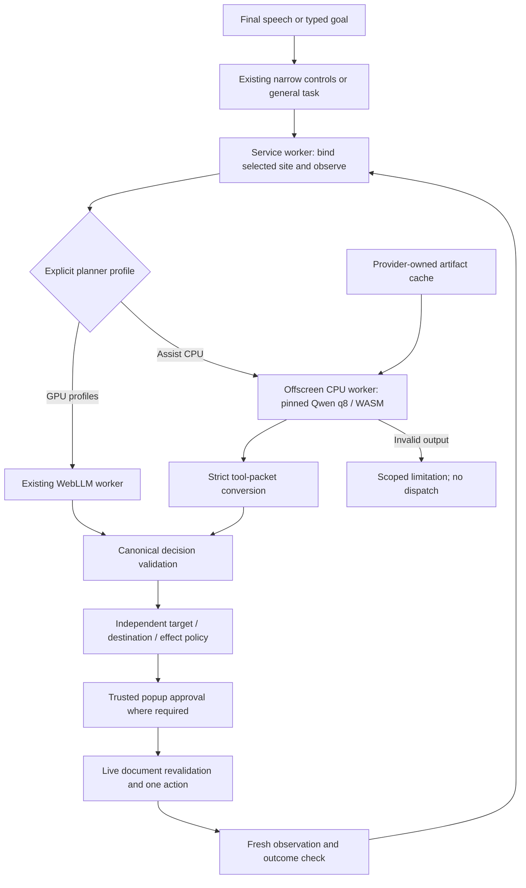

# GPU-independent local planning

Updated 17 November 2026. Assist CPU is an experimental, fully local planner backend. Essential remains the default basic-control profile; existing saved profile selections are preserved.

**Qualification failed:** the current small model produced zero correct decisions across three synthetic task checks. It runs without a GPU, but is not ready for dependable general site tasks. This is an implementation and measurement baseline, not a production accuracy claim.

## Use

1. Build with `npm run check`, reload the unpacked extension and refresh target pages.
2. Choose **Assist CPU (no GPU; experimental)** in Settings → Model, or choose Assist CPU during setup.
3. Allow the first download to complete. The pinned planner has 512,096,557 bytes of q8 ONNX weights, plus approximately 7 MB of tokenizer/config files. Speech weights are separate.
4. Describe a task on the current site. The same site-aware coordinator validates targets, checks policy, requests approvals and observes results.

No WebGPU adapter or device is requested by this backend. It still needs CPU time, memory and browser support for the bundled ONNX WASM runtime. A CPU backend removes GPU dependence; it does not guarantee fast or accurate general reasoning on every low-end device.

CPU setup prepares speech and planning before reporting complete. Mic pause/resume reuses live workers. After idle eviction or browser/extension restart, weights reopen from the provider cache; that is initialization rather than a new download. Browser cache eviction or missing files can require downloading again.

## Implementation

- `shared/cpu-planner-config.json` pins the model revision, q8 artifact size and SHA-256 for benchmark preparation. The model is `onnx-community/Qwen2.5-0.5B-Instruct`, revision `22942cb7d7ba4cc81bb4673549ca4d4614469b5e`, converted from the Apache-2.0 Qwen instruct model. [Conversion repository](https://huggingface.co/onnx-community/Qwen2.5-0.5B-Instruct), [upstream model and license](https://huggingface.co/Qwen/Qwen2.5-0.5B-Instruct).
- `offscreen/llm/cpu-worker.ts` uses Transformers.js with explicit `device: "wasm"`, `dtype: "q8"`, one thread and packaged version-matched ONNX WASM/glue. It imports the shared protocol types without loading the WebLLM engine.
- Model load/generation is single-flight. File progress is monotonic and readiness follows pipeline initialization. Provider Cache Storage owns downloaded files.
- CPU prompts use smaller retrieved contexts and tool formats selected from the currently observed controls, without matching a hardcoded vocabulary of user commands. Input is limited to 3,072 tokens without silent goal truncation; output is limited to 256 tokens.
- A compact tool packet, such as `{"tool":"type","target":"e1","value":"backpacks"}`, converts to the canonical site decision. Unexpected fields, invalid targets, unknown tools and missing evidence are rejected. Conversion preserves model arguments; it never guesses a target or repairs an action into apparent success.
- Generation starts with an assistant JSON prefix and stops after one complete JSON object. This is a formatting aid, not grammar-constrained decoding. The worker rejects incomplete JSON; the runtime and coordinator validate the complete decision schema and enforce existing safety policy independently.
- Stop/cancellation terminates the CPU worker immediately, including a non-yielding WASM kernel. The next request can reopen cached weights. Cancellation does not trigger the GPU recovery/reload loop.
- CPU and GPU profiles remain explicit choices. There is no remote-inference fallback and no automatic switch from CPU to GPU.
- Provider cache metadata distinguishes cached reads from transfers; both can emit Transformers.js progress events. No second cache or downloader is introduced. CPU setup permits up to 15 minutes for the initial download instead of the shorter on-demand planner wait.



The manifest hash is checked by benchmark preparation. Runtime downloads use the pinned revision and HTTPS through the inference provider; this change does not introduce a separate runtime artifact-hashing cache or claim a complete supply-chain integrity system.

## Why this model/backend

The installed Transformers.js/ONNX stack already runs speech locally and can share its packaged WASM binary with a CPU planner. This avoids a required native application or server account. A native companion remains separate future work. [Hosted assist](HOSTED_PLANNER.md) now provides an explicit external-service alternative with its own configuration and sharing consent.

The first candidate, SmolLM2-360M-Instruct q8, initialized on CPU without GPU requests but failed all three initial structured-decision fixtures. A shorter prompt/JSON prefix still copied page metadata instead of producing correct decisions. Qwen2.5-0.5B was evaluated next; shorter packets, few-shot examples and narrower tool inventories also failed task qualification. Its native function-call template also failed all three checks, taking about 36–40 seconds per decision versus about 13–20 seconds for the shorter packets. The shorter protocol is retained to avoid that added cost without a measured accuracy improvement. Invalid outputs were rejected before any browser action. Qwen remains a pinned experimental baseline, not an endorsed replacement for a qualified larger model.

Fine-tuning/distillation is not part of this change. A future VoxPilot-specific model needs consented labeled tasks, held-out sites and measured improvements over these baselines. Fine-tuning alone does not reduce inference model size.

## Reproduce the actual CPU benchmark

Requires Node 22+ with global WebSocket, `curl`, and Chrome/Chromium. Set `CHROME_PATH` if Chrome is not found automatically.

```sh
npm run benchmark:cpu:prepare
npm run benchmark:cpu
```

Preparation downloads the immutable public artifacts into an OS temporary cache and checks the ONNX weight SHA-256 against the pinned manifest. Set `VOXPILOT_CPU_MODEL_DIR` for a different cache location. Weights are not added to the repository or extension package.

The benchmark creates a fresh temporary Chrome profile, disables GPU acceleration/WebGPU, and makes a GPU adapter request fail if attempted. It runs the actual CPU worker and production next-step prompt/parser. Weights are staged on localhost, so initialization measurements exclude internet download time. A warm sample reuses the same worker; it does not measure a warm browser restart.

The report contains model/revision/backend, initialization and generation timings, token usage when available, GPU request count, schema validation, explicit task correctness and decisions for public synthetic fixtures. It also starts a fresh worker to check provider-cache reopening, download labels and weight transfer count. It executes no browser mutations. Schema validity alone is not task correctness. The command exits unsuccessfully on wrong decisions, unexpected GPU access or cache-check failure. A failing qualification report is expected with the current model. These fixtures do not establish accuracy on arbitrary sites or an end-to-end voice latency SLO.

## Measured baseline

On an Intel Core i7-1068NG7 (4 physical cores, 16 GiB RAM), isolated Chrome with GPU disabled and one WASM thread, the observed-control-only prompt failed all three checks: first search, warm search and unsupported cart request on a read-only article. Initial model preparation took 8.6 seconds; reopening provider-cached weights in a fresh worker took 5.8 seconds, with zero cached-read download events and one total weight transfer across both workers. Earlier compact-packet runs sometimes produced valid JSON with the wrong action; the benchmark now checks correctness independently. See the [recorded reports](benchmarks/cpu-planner-2026-11-16.json) for both protocols, timings and rejected outputs. Internet transfer time, microphone recognition and browser actions are excluded. These results do not support a low-latency or production-readiness claim.

Before recommending CPU general planning, qualify another model or a distilled model on held-out tasks and sites, including unsupported requests, prompt injection, clarification, multi-step search and cart approval. Larger CPU models trade memory/download size and latency for possible accuracy; they must pass the same benchmark before replacing this baseline. A native companion may improve CPU inference performance but adds installation/IPC maintenance. [Hosted assist](HOSTED_PLANNER.md) now provides the explicitly selected remote path, with connectivity, data-transfer and operating-cost tradeoffs. It is never substituted automatically for a local profile.

Unit/regression tests cover CPU worker routing, pinned WASM loading, context limits, JSON termination, cancellation/late-result suppression, single-flight generation, setup readiness and progress monotonicity. The existing browser task fixtures separately exercise real DOM execution and approvals with a scripted decision provider.

## Current boundaries

Assist CPU is experimental. Keep approval/verification gates enabled and report unsupported or uncertain tasks accurately. Browser cache availability, page complexity, CPU speed and the model's ability to follow the decision format affect usefulness. Multi-frame/vision support, qualified business outcome verifiers, broader hardware scorecards and the existing optional WebLLM distribution work remain tracked in the [site-agent implementation status](SITE_AGENT_IMPLEMENTATION.md).
