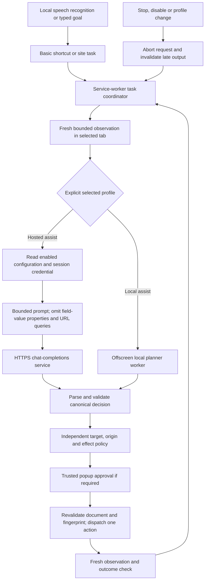

# Hosted assist without a device GPU

Updated 17 November 2026.

Hosted assist is an explicitly selected planner backend. It moves general-task inference to a configured service while speech recognition, speech output, page inspection, approvals and browser actions remain local. It avoids the device GPU, the local planner download and browser GPU lifecycle failures for this profile. Essential remains the default; no local profile automatically falls back to a hosted service.

## Configure

1. Run `npm run check`, reload the unpacked extension at `chrome://extensions`, and refresh target pages.
2. Open Settings → Model and select **Hosted assist (no device GPU)**.
3. Enter your service's complete chat-completions URL and model ID. Use HTTPS. HTTP is accepted only for an explicitly configured loopback gateway: localhost or 127.0.0.1.
4. If required, enter a session API key. It is kept in trusted Chrome session storage, bound to the endpoint, and is not returned to the popup or Settings. Re-enter it after the browser session ends. A blank key preserves the existing key only for the same endpoint.
5. Read the sharing notice, check consent and choose **Enable hosted assist**. Changing the endpoint or model clears the form's consent checkbox. Saving settings itself makes no inference request.
6. Start listening or type a goal in the popup. The popup shows the configured hosted origin. Search, form entry and cart requests use the same observe–decide–act–verify loop and operation approvals.

Disable hosted assist in Settings to cancel current work and remove its session key. Select Essential for local basic commands. Closing the popup does not stop the microphone or change the planner selection.

While the microphone is on, recognized utterances are treated as commands. General utterances in Hosted assist can therefore send selected page context to the service even while the popup is closed. Pause listening or choose a local profile when you do not want that sharing.

No provider subscription, running gateway, model account or credential is bundled. Live-model qualification requires a configured service. Do not send API keys through chat, page forms or voice clarification; use the extension's Settings field.

## Service contract

The client implements the OpenAI-compatible Chat Completions HTTP format, without an SDK or a fixed vendor/model:

- POST the configured URL, with JSON content and an optional Bearer credential.
- Send `model`, bounded `messages`, `response_format: {type: "json_object"}`, `max_tokens: 384`, `stream: false`, and `store: false`.
- Expect exactly one decision in `choices[0].message.content`, with `finish_reason: "stop"`. Refusal, truncation, tool-call envelopes and invalid decisions are rejected.

JSON mode does not guarantee schema correctness; canonical validation and policy remain mandatory. See the [official JSON-mode documentation](https://developers.openai.com/api/docs/guides/structured-outputs). A compatible gateway must adapt providers requiring other authentication headers, parameter names, signed requests or response formats. The client does not silently retry with weaker formats or another provider.

Requests use no browser cookies, no ambient credentials, no referrer and no redirects. The request deadline is the smaller of 25 seconds and the remaining site-task budget; it includes body reading. Responses are capped at 64 KiB even without Content-Length. Abort races release the request lock even if a transport fails to acknowledge cancellation. Late results cannot resume a stopped task.

The service can still incur charges after a request is cancelled. It controls its own retention policy; sending `store: false` does not establish that the service never retains data.

## Architecture

The background service worker owns hosted networking and credentials. Neither page content scripts nor offscreen inference workers receive the API key. Only the top-level Settings document can read configuration status or save credentials. Configuration status never includes the key. Privileged extension HTML pages are no longer web-accessible resources. Content scripts run in the top frame, matching the executor's supported scope.

## Data boundary and guardrails

Sent context includes the user's goal, clarification answers, selected page title/prose, bounded labels/context, form metadata, opaque element IDs and recent action outcomes. Explicit field-value and fingerprint properties are omitted. Observed URL query strings, fragments and embedded credentials are removed; links requiring those parts can still be activated through observed handles. URL paths, page prose and the user's own command can contain private information, so this is data minimization, not comprehensive redaction.

Text extraction now excludes textarea and editable-region contents from labels, prose, surrounding form context and form-text fingerprints. CSS-hidden and fully transparent text is also excluded, so hidden status messages cannot become visible outcome evidence. This closes indirect routes by which values or invisible results could otherwise appear in parent text. Site pages can still put private information into ordinary visible prose or labels.

Provider output has no direct browser or extension API access. Existing same-origin/observed-target checks, secret-field handoffs, cart approvals, live document/fingerprint checks, bounded discovery and UI evidence verification all remain active. Requests to dictate API credentials, access tokens, passwords or seed phrases are rejected by the coordinator. These patterns are a conservative floor, not comprehensive semantic detection of every secret or unsafe effect.

Failures return a limitation without dispatching the rejected decision. Earlier verified steps can remain. No failed model call or uncertain browser mutation is replayed automatically.

## Why this approach

| Choice | Decision and tradeoff |
|---|---|
| Hosted inference | Removes local planner GPU/memory requirements and permits a more capable service model. Requires connectivity, explicit data sharing and service operating costs. Latency and accuracy depend on the chosen service. |
| Small in-extension CPU model | Retained as experimental. The tested small models failed task qualification; adding more prompt variants did not establish useful accuracy. |
| Native CPU companion | Deferred. It can use more efficient native inference, but adds installation, executable distribution, native messaging and upgrade maintenance. |
| Browser-native AI | Deferred. Browser/model availability and hardware requirements vary; it is not assumed to provide universal GPU-free inference. |
| Provider-neutral HTTP adapter | Keeps one validated decision contract and avoids a vendor SDK or model-specific browser code. Services must support the stated format or use an adapter gateway. |
| Session credential | Avoids persisting a provider key to disk through extension local storage. Browser/extension compromise can still expose session memory. |
| Fixed production gateway | Recommended for distributing the product: authenticate users, enforce quotas/billing and keep provider credentials server-side. Do not ship a shared provider secret in extension code. This change does not deploy that gateway or create user accounts. |
| Explicit endpoint rather than page-supplied destination | Prevents a site or model response from redirecting prompts or credentials to its own service. Redirects are rejected. |

Supporting user-configured HTTPS endpoints requires broader HTTPS network CSP than a fixed gateway. Executable CSP remains self-only plus packaged WASM. Existing broad page host permissions remain; migration to optional per-origin grants is still separate work. For a fixed production deployment, pin the gateway and narrow both network CSP and host permissions.

## Verification and remaining qualification

`npm run check` covers source checks, regression tests, production build and packaged assets. Tests cover disabled consent, endpoint validation, credential isolation/binding, cancellation during configuration and networking, hung transport cancellation, response limits, HTTP errors, refusal/truncation, arbitrary tools, hosted profile routing and secret clarification.

`npm run test:browser` uses real Chrome and a scripted local HTTP service to exercise the production hosted client, native search form entry/submission, cart approval and one mutation, invalid-tool rejection, live HTTP cancellation, editable-content privacy, popup sharing status, and Settings consent/session-key/disable behavior at desktop and narrow widths. It makes no external provider calls and performs no real purchases.

These HTTP fixtures establish transport and orchestration behavior, not real-model comprehension, end-to-end voice latency or arbitrary-site task success. No live provider credentials were supplied or used. Before production, qualify the selected service model on held-out sites/tasks, deploy and test its authentication/quota controls, validate the installed MV3 extension with real audio and long sessions, and complete store/privacy review. Cross-origin frames, closed shadow roots, vision, transactional undo and business-specific outcome verifiers remain outside this implementation.
